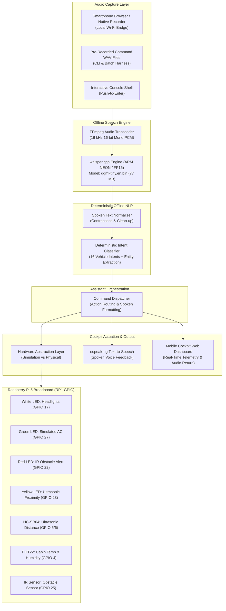

# In-Vehicle AI-Driven Digital Voice Assistant (Raspberry Pi 5)

An offline, embedded digital voice assistant for a simulated vehicle cockpit built from scratch on a **Raspberry Pi 5 Model B (8 GB RAM)** running **Debian 13 (Trixie) ARM64**.

Powered by local **whisper.cpp** speech recognition, deterministic offline intent parsing, real-time RP1 GPIO hardware integration, text-to-speech output, and a local Wi-Fi smartphone voice bridge.

---

## 1. System Architecture



---

## 2. Hardware Wiring & Electrical Safety Guide

> [!CAUTION]
> **3.3V Logic Warning**: Raspberry Pi 5 GPIO lines are **3.3V maximum** and are **NOT 5V tolerant**. Applying 5V directly to a GPIO input will permanently destroy the RP1 I/O pad or the board.

### Complete Pin Assignment Table

| Component | Pin Function | Raspberry Pi BCM Pin | Physical Header Pin | Electrical Protection |
|---|---|---|---|---|
| **White LED** | Headlights (+) <br> Ground (-) | **GPIO 17** <br> **GND** | **Pin 11** <br> **Pin 9** | **330 Ω** current-limiting resistor (~3.3 mA) |
| **Green LED** | AC Indicator (+) <br> Ground (-) | **GPIO 27** <br> **GND** | **Pin 13** <br> **Pin 14** | **330 Ω** current-limiting resistor (~3.3 mA) |
| **Red LED** | IR Obstacle Alert (+) <br> Ground (-) | **GPIO 22** <br> **GND** | **Pin 15** <br> **Pin 14 (Rail)** | **330 Ω** current-limiting resistor (~3.9 mA) |
| **Yellow LED** | Ultrasonic Proximity (+) <br> Ground (-) | **GPIO 23** <br> **GND** | **Pin 16** <br> **Pin 14 (Rail)** | **330 Ω** current-limiting resistor (~3.3 mA) |
| **IR Sensor** | VCC <br> GND <br> OUT | **3.3V Power** <br> **GND** <br> **GPIO 25** | **Pin 1** <br> **Pin 9 (Rail)** <br> **Pin 22** | Powered via 3.3V to ensure safe 3.3V logic output |
| **HC-SR04 Ultrasonic** | VCC <br> GND <br> TRIG <br> **ECHO (5V)** | **5.0V Power** <br> **GND** <br> **GPIO 5** <br> **GPIO 6** | **Pin 2** <br> **Pin 30 (Rail)** <br> **Pin 29** <br> **Pin 31** | **MANDATORY VOLTAGE DIVIDER** (steps 5V down to 2.85V) |
| **DHT22 / AM2302** | VCC <br> GND <br> DATA | **3.3V Power** <br> **GND** <br> **GPIO 4** | **Pin 17** <br> **Pin 25 (Rail)** <br> **Pin 7** | Pull-up resistor to 3.3V |
| **SG90 Servos** | VCC <br> GND <br> PWM | **External 5V** <br> **Shared GND** <br> **GPIO 12, 13** | External Supply <br> External & Pi GND <br> **Pin 32, 33** | **Power-isolated**. Never power from Pi 5V header. |

### HC-SR04 Voltage Divider Circuit
The HC-SR04 transducer operates on 5V and outputs a 5.0V echo pulse. We step this down using standard resistors:
* **$R_1 = 1.0\text{ k}\Omega$** between ECHO and Node A.
* **$R_2 = 1.33\text{ k}\Omega$** (1 kΩ + 330 Ω in series) between Node A and GND.
* **Node A** connects to **GPIO 6 (Physical Pin 31)**.
$$V_{out} = 5.0\text{ V} \times \frac{1330\,\Omega}{1000\,\Omega + 1330\,\Omega} \approx 2.85\text{ V}$$
*(2.85V is reliably recognized as digital HIGH by the Pi while remaining strictly under the 3.3V limit).*

---

## 3. Supported Voice Commands & Intent Vocabulary

| Intent | Canonical Phrasing | Supported Natural Variations | Physical / Simulated Action |
|---|---|---|---|
| `GREETING` | *"Hello assistant"* | *"Hi"*, *"Good morning"*, *"Hey"* | Vocal welcome response |
| `GET_TEMPERATURE` | *"What is the cabin temperature?"* | *"How hot is it?"*, *"Cabin temp"*, *"Check temperature"* | Reads genuine DHT22 sensor reading in °C |
| `GET_HUMIDITY` | *"What is the humidity?"* | *"How humid is it?"*, *"Check humidity level"* | Reads genuine DHT22 relative humidity in % |
| `GET_DISTANCE` | *"How far is the obstacle?"* | *"Check distance"*, *"How close is the wall?"* | Reads genuine HC-SR04 ultrasonic distance in cm |
| `GET_SENSOR_STATUS` | *"Check the vehicle sensors"* | *"Sensor diagnostics"*, *"Are sensors working?"* | Full sensor health check and diagnostic readout |
| `LIGHTS_ON` | *"Turn on the lights"* | *"Headlights on"*, *"Switch on lights"* | Asserts GPIO 17 HIGH $\rightarrow$ **White LED turns ON** |
| `LIGHTS_OFF` | *"Turn off the lights"* | *"Headlights off"*, *"Switch off lights"* | De-asserts GPIO 17 LOW $\rightarrow$ **White LED turns OFF** |
| `TURN_AC_ON` | *"Turn the AC on"* | *"Start climate control"*, *"Switch on AC"* | Asserts GPIO 27 HIGH $\rightarrow$ **Green LED turns ON** |
| `TURN_AC_OFF` | *"Turn the AC off"* | *"Stop climate control"*, *"Switch off AC"* | De-asserts GPIO 27 LOW $\rightarrow$ **Green LED turns OFF** |
| `GET_AC_STATUS` | *"What is the AC status?"* | *"Is the AC on?"*, *"Check AC state"* | Reports whether simulated AC is currently active |
| `OPEN_DOOR` | *"Open the driver door"* | *"Open passenger door"*, *"Open both doors"* | Resolves target door (`driver`/`passenger`/`both`) |
| `CLOSE_DOOR` | *"Close the door"* | *"Shut passenger door"*, *"Lock doors"* | Closes targeted door; explains defaults if ambiguous |
| `HELP` | *"Help me please"* | *"What can you do?"*, *"List commands"* | Spoken list of all available voice features |
| `EXIT` | *"Exit the application"* | *"Shutdown"*, *"Goodbye"*, *"Quit"* | Gracefully releases GPIO lines and exits |

---

## 4. Running the Project

All commands should be executed from the project root inside the Python virtual environment:

```bash
cd ~/car-voice-assistant
source .venv/bin/activate
export PYTHONPATH=.
```

### Mode 1: Mobile Smartphone Wi-Fi Voice Bridge (Recommended Demo)
Turns any Android/iOS smartphone on the same Wi-Fi network into a wireless microphone:

```bash
python -m app.main --web --mode physical --port 8080
```
1. Open your phone's browser to: `http://<PI_IP>:8080` (e.g. `http://172.29.39.239:8080`).
2. Tap the central **🎙️ Microphone** button (or **"📁 Use Phone Sound Recorder"**).
3. Speak any vehicle command—watch the breadboard LEDs react and hear the voice response!

### Mode 2: Single Audio File Execution
Process a single WAV recording directly through `whisper.cpp`:

```bash
# Read genuine DHT22 temperature:
python -m app.main --audio app/audio_samples/cabin_temp.wav --mode physical --tts

# Turn on the physical headlights LED:
python -m app.main --audio app/audio_samples/lights_on.wav --mode physical --tts
```

### Mode 3: Interactive Command Shell
Interactive keyboard / audio path testing without a microphone:

```bash
python -m app.main --interactive --mode physical
```

### Mode 4: Automated Batch Benchmark
Runs 15 distinct pre-recorded voice commands through `whisper.cpp` and benchmarks speech recognition latency and accuracy:

```bash
python -m app.main --batch app/audio_samples
```

---

## 5. Offline SVM Intent Classifier Pipeline

The assistant features an **offline-trained Support Vector Machine (LinearSVC)** integrated with deterministic syntax parsing and compound command segmentation:

- **Feature Pipeline**: Scikit-learn `Pipeline` combining Word (1–2 n-grams) and Character-wb (3–5 n-grams) TF-IDF vectors with balanced class-weighted `LinearSVC(C=1.5)`.
- **Learned Intent Classes (20 classes)**:
  `LIGHTS_ON`, `LIGHTS_OFF`, `GET_LIGHTS_STATUS`, `TURN_AC_ON`, `TURN_AC_OFF`, `GET_AC_STATUS`,
  `OPEN_DOOR`, `CLOSE_DOOR`, `GET_DOOR_STATUS`, `GET_TEMPERATURE`, `GET_HUMIDITY`, `GET_DISTANCE`,
  `GET_SENSOR_STATUS`, `EMERGENCY_ON`, `EMERGENCY_OFF`, `GREETING`, `HELP`, `EXIT`, `STOP_LISTENING`, `UNSUPPORTED`.
- **Local Model Artifact**: `app/models/intent_svm.joblib` (120.55 KB) & `app/models/intent_svm_meta.json`.
- **Offline Guarantee**: Requires strictly 0 external network calls. Operates entirely in RAM with sub-2 ms inference latency.

### Train the SVM from Scratch
```bash
python scripts/train_intent_svm.py
# Or via main CLI:
python app/main.py --train-svm
```

### Evaluate on Held-Out Test Split
```bash
python scripts/evaluate_intent_svm.py --split test
# Or via main CLI:
python app/main.py --eval-svm --split test
```

### Test Individual Voice Commands
```bash
# Test intent prediction via SVM CLI:
python scripts/evaluate_intent_svm.py --predict "turn on the headlights and switch on the ac"

# Execute end-to-end in vehicle simulation mode:
python app/main.py --mode simulation --text "Close both doors if they are open, and don't close them if only one is open."
```

---

## 6. Diagnostics & Hardware Self-Tests

### All-in-One Hardware Diagnostic
Verifies all indicator LEDs, the IR sensor, HC-SR04 distance sensor, and DHT22 climate sensor in one automated test without needing a microphone:

```bash
python app/scripts/check_all_hardware.py
```

### Interactive Breadboard Diagnostic Menu
Test individual components one-by-one:

```bash
python app/scripts/test_hardware.py
```

### Run Automated Unit Test Suite
46 unit and integration tests covering SVM intent classification, compound commands, conditional doors, speech transcription, safety locks, audio synthesis, and the web bridge:

```bash
python -m unittest discover -s app/tests
```

---

## 7. Performance Benchmarks (Raspberry Pi 5 ARM64)

* **Speech-to-Text Engine**: `whisper.cpp` (`tiny.en`, 77.11 MB)
* **Intent Classification Engine**: Offline `LinearSVC` with Word+Char TF-IDF (120.55 KB)
* **CPU Hardware Acceleration**: ARM Cortex-A76 with NEON, FP16_VA, and DOTPROD vector extensions
* **SVM Layer A Test Accuracy**: **88.00%** (Held-Out Test Set)
* **SVM Layer A Test Macro F1**: **87.90%** (Held-Out Test Set)
* **Pipeline Layer B Overall Match**: **97.06%** (66 / 68 Held-Out Test Commands)
* **Compound Command Handling**: **100.00%** (18 / 18 Multi-Action Sequences)
* **Unsupported Rejection Rate**: **100.00%** (8 / 8 Out-of-Domain Requests Safely Rejected)
* **Average SVM Inference Latency**: **~1.72 milliseconds** (p95: 2.53 ms)
* **Average Speech Recognition Latency**: **~1.08 seconds**
* **Total End-to-End Latency (Microphone to Actuation)**: **~1.15 seconds**
* **Peak RAM Consumption**: **< 175 MB**

